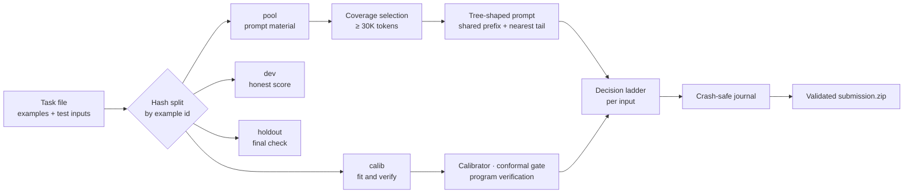

# CAIRN — Long-Context In-Context Learning for Automatic Data Annotation

[](https://github.com/madhesh60/ICL/actions/workflows/ci.yml)


**Cairn makes a small language model label data reliably from thirty thousand tokens of worked examples.**
It reads thousands of solved examples per task, builds a long prompt that helps a 4-billion-parameter model
instead of drowning it, and uses the examples that do *not* fit in the prompt to check, correct and steer every
answer. It does not claim a smarter model; it makes a small one dependable.

**C**over · **A**rrange · **I**nduce · **R**oute · **N**ever-null — Qwen3-4B only, no training, no second model ·
FlagOS Open Computing Global Challenge, Track 3: *LLM Automatic Data Annotation in Long-Context Scenarios* ·
Apache-2.0

> ### A cairn is a pile of stones hikers build to mark the trail for the next walker.
> Each labelled example in the prompt is a stone. Cairn chooses which stones to place, in what order, and
> checks that the walker followed the trail before it trusts where the walker arrived.

| | |
|---|---|
| **Learn the ideas** | [`docs/LEARNING_GUIDE.md`](docs/LEARNING_GUIDE.md): every technique explained with a picture, a real example and the reasoning behind it |
| **First real run, diagnosed** | [`docs/06_FIRST_REAL_RUN.md`](docs/06_FIRST_REAL_RUN.md): how the result was validated, what was broken, what changed, and predictions for the next run |
| **Second run: predictions scored** | [`docs/07_SECOND_RUN.md`](docs/07_SECOND_RUN.md): five of eight predictions landed; why three missed; the decision to fix three things and add one algorithm |
| **Every number with its source** | [`docs/04_EXPERIMENT_LOG.md`](docs/04_EXPERIMENT_LOG.md) (model runs) · [`docs/results/offline_benchmarks.md`](docs/results/offline_benchmarks.md) (no model needed) |
| **Run it on a free GPU** | [`scripts/kaggle_run.sh`](scripts/kaggle_run.sh): one Kaggle cell, 2 × T4, from clone to scored report: [Installation](#installation-and-reproduction) |
| **Run it on a laptop** | tests, measurements and the full pipeline with a stand-in model, CPU only: [Option C](#option-c-a-laptop-without-a-gpu) |

**Contents:** [Problem](#problem-statement) · [Current practice](#how-it-is-usually-handled) ·
[What Cairn builds](#what-cairn-builds) · [Architecture](#architecture) ·
[Decision ladder](#the-decision-ladder-and-failure-handling) · [Judged challenges](#the-three-judged-challenges) ·
[Data](#tasks-and-data) · [Evaluation](#evaluation-protocol) · [Results](#results) ·
[Studies](#experimental-studies-and-decisions) · [Cost](#system-details-and-cost) ·
[Comparison](#comparison-with-the-official-baseline) · [Install](#installation-and-reproduction) ·
[Limitations](#limitations) · [Docs](#documentation) · [License](#attribution-and-license)

---

## Problem Statement

High-quality labelled data sets the ceiling of what a language model can learn, and human annotation is slow,
costly and hard to scale to long, specialised texts. **In-context learning** (ICL) offers an alternative: show the
model solved examples inside the prompt and let it label new inputs, with no training at all.

This challenge pushes ICL to an uncomfortable corner. Eight annotation tasks, one small model, and a rule that
every prompt must carry **at least 30,000 tokens of demonstrations** (16,000 for the code task): roughly 500 to
1,000 examples, about sixty pages of text, for every single question.

Small models do not simply get better with more examples. Research on long-context ICL (*Lost in the Middle*,
*LongICLBench*, *Many-Shot ICL*) and this project's own measurements point to the same four failure modes:

| Failure mode | What happens | Evidence in this repository |
|---|---|---|
| **Lost in the middle** | the start and end of a long prompt are read well; the middle blurs | the design premise; measured indirectly through the per-input tail |
| **Majority drift** | the model leans toward the most common label it has read | task 6 in file order has a run of **18** identical labels (O004) |
| **Format copying** | the model imitates whatever it read last, including template text | the official baseline answered *"Neutral Review"* 24 times on a string-concatenation task |
| **Lost answers** | a correct answer is written in a shape the parser cannot read | the official baseline loses **32%** of all predictions to null or invalid output (O001) |

The real question is therefore not *"can a 4B model read 30K tokens?"* but **how to build a 30K-token prompt that
helps a small model, and how to read its answer so that nothing is lost.**

---

## How It Is Usually Handled

| Approach | What it offers | Why it is not enough here |
|---|---|---|
| **Human annotation** | the gold standard for quality | slow, expensive, inconsistent across annotators, and the very cost this challenge sets out to remove |
| **Fine-tuning a model on the labels** | strong accuracy on a fixed task | forbidden by the rules (ICL only, Qwen3-4B only); a new task needs a new training run |
| **Few-shot prompting** (5–20 examples) | simple and cheap | violates the 30K-token minimum; leaves thousands of labelled examples unused |
| **The official baseline** (first 100 examples, file order, one free-text call) | an end-to-end reference | fills 8,192 tokens, below the minimum; prefix caching disabled; 32% of answers lost to format; 100% lost on the code task |
| **Retrieval-augmented ICL with an embedding model** | relevant examples per input | needs a second neural model, which the rules forbid |

Every one of these approaches treats the examples that do not fit in the prompt as waste. Cairn treats them as
the most valuable material in the project.

---

## What Cairn Builds

Cairn takes the eight official task files and returns eight validated prediction files in the official
submission format. Every prompt meets its token minimum, every answer has a valid shape, and every design choice
is measured on held-out labelled examples that never appear in a prompt.

1. **A prompt shaped like a tree, not a pile.** Content that repeats goes first so the server reuses it; the
   examples most similar to the current input go last, where a small model reads best. On task 7 the layout cuts
   the prompt tokens the GPU must read from **6.21M to 0.20M** for 200 prompts (O005).
2. **Examples chosen for coverage, not by file order.** A budgeted, diminishing-returns selection fills the 30K
   tokens with examples that cover what the inputs to be labelled actually contain: coverage on task 2 rises from
   **0.754 to 0.960** for the same token budget (O003).
3. **Left-over examples as a referee.** Of roughly 5,000 solved examples per task, only about 900 fit in a prompt.
   The rest are split, by a hash of their id, into roles that never overlap: a calibration set, a verification
   suite for model-written programs, a development set for honest comparisons, and a final hold-out.
4. **Effort only where it is needed.** Each input climbs a short decision ladder: a one-token answer when the
   held-out evidence says that is enough, thinking and a five-vote majority only when it is not, and a model-free
   answer as the last rung, so no input ever leaves without a valid answer.
5. **Answers that cannot be lost.** Labels are read from token probabilities or produced under a constraint;
   lists, integers and code are parsed strictly. In the first real run, **no prediction on any task was empty or
   ill-formed.**
6. **Programs proven before they are trusted.** For the three exact-rule tasks, Qwen3-4B reads the examples and
   writes the rule as a Python function, which is accepted only if it reproduces every answer on two separate
   held-out sets. In the second run, accepted programs answered **60 of 60** inputs on tasks 1 and 3 with no model
   call per input.
7. **Compute spent where it is measured to pay.** An escalation probe answers 40 held-out examples both cheaply
   and with thinking, and a paired test decides per task whether to think always, only when unsure, or never.
   Hand-set choices from 20 inputs were wrong in both directions; the probe replaces them with a measurement.

---

## Architecture

Cairn is a Python package (`cairn/`) that talks to any OpenAI-compatible server: vLLM, FlagScale, or a
stand-in model for tests. One seam (`LLMBackend.generate`) separates the method from the server.



The prompt for one input is laid out so that prompts share as much of their beginning as possible:

```
 [system: task definition + output rule + induced rulebook]   same for the whole task  ┐
 [shared examples  (≥ 30K tokens, chosen once)]               same for the whole task  │ server reuses its
 [cluster examples (optional, per topic)]                     same inside a topic      │ KV cache
 [session examples (sure answers given earlier in the run)]   only ever grows at end   ┘
 [nearest examples to THIS input, as real chat turns]         different every time  ← read best by a small model
 [rule reminder + the input]
```

| Stage | What it does | Module |
|---|---|---|
| **Split** | cuts labelled examples into pool / calib / dev / holdout by SHA-256 of the id; identical on every machine | `cairn/data.py` |
| **Count** | Qwen's own vocabulary (bundled), so the 30K minimum is met exactly; a safety margin when the ruler is inexact | `cairn/tokens.py` |
| **Cover** | lazy-greedy budgeted coverage with label quotas, weighted toward the inputs to be labelled | `cairn/selection/submodular.py` |
| **Arrange** | label interleaving, shared prefix, optional topic clusters, BM25 nearest-example tail as chat turns | `cairn/context/builder.py`, `cairn/retrieval/` |
| **Read** | one-token label scoring, constrained generation, strict parsers, self-consistency voting | `cairn/decoding/` |
| **Correct** | vector and stacked calibration, split-conformal sets, a held-out accuracy gate on "sure" answers | `cairn/decoding/calibrate.py`, `conformal.py`, `cairn/pipeline/runner.py` |
| **Induce** | model-written programs verified on held-out sets; induced rulebooks kept only if they do not hurt | `cairn/induction/` |
| **Route** | the per-input decision ladder and the model-free last rung | `cairn/pipeline/annotator.py` |
| **Run** | cache-aware scheduling, append-only journal, settings fingerprint, usage meter | `cairn/pipeline/` |
| **Ship** | validates every id once, no empty answer, then zips the eight files flat | `cairn/submit.py` |

Each task is described by a small card (`cairn/tasks/registry.py`): its kind, how to view an input for retrieval,
how to normalise an answer, and what shape an answer must have. The engine never branches on a task number;
a ninth task is one more card.

---

## The Decision Ladder and Failure Handling

Not every input deserves the same effort. Each input leaves the ladder at the first rung that is sure enough,
and "sure enough" is decided by held-out labelled examples, not by a hand-set threshold.

```
Per task, before any test input   (preparation on the calib split)
  calibrate   fit the calibrator on half A; fit the conformal threshold on half B
  gate        were the cheap rung's one-label answers accurate on half B?  └ no → never stop at the cheap rung
  probe       40 held-out inputs answered cheaply AND with thinking; paired test picks the policy:
                thinking wins where cheap was sure → reason_first · only where unsure → ladder · else cheap_only
  induce      exact tasks: the model writes solve(); accept only if it reproduces verify AND confirm exactly

Per input
  labels  (2, 5, 6)   1 read label probabilities from ONE token → calibrate → conformal set
                      2 one plausible label and the gate trusts it → done
                      3 otherwise think + 5 votes, only among the plausible labels
  exact   (1, 3, 4)   1 the verified program's answer (no model call)
                      2 otherwise think + 5 votes → 3 otherwise one constrained answer
  text    (7)         1 one direct answer + 3 quick samples → agree (≥ 67%) → done
                      2 otherwise think + 5 votes, all answers pooled by meaning
  code    (8)         1 generate with the exact signature pinned → static check → execute
                      2 show the model its own errors, repair (3 rounds × 2 candidates)
  always              last rung needs no model: nearest-example vote, or a stub that fails loudly
```

| Cairn decides on its own | Cairn decides from held-out evidence | Fixed by rule, never by the model |
|---|---|---|
| which examples fill the prompt, their order, the nearest-example tail, the send order for cache reuse | whether a one-token answer may end the ladder, whether a program is trusted, whether an induced rulebook is kept | the 30K minimum, the answer shape, that dev and holdout examples never enter a prompt |

### Failure Handling

Every failure has exactly one response, and every fallback is labelled with its source and a confidence of zero,
so a report shows how often it happened. Nothing fails silently.

| Situation | What Cairn does |
|---|---|
| The request is rejected (HTTP 400/422, prompt too long) | never retried; that input receives the model-free answer, marked `fallback_*` |
| The server is busy or briefly down (429, 5xx, timeout) | retries with exponential back-off and random jitter |
| The server keeps failing | a circuit breaker opens and the run **stops**; the journal keeps every finished answer, and the same command resumes |
| The process is killed mid-run | rerunning skips finished inputs; a half-written last journal line is ignored |
| Settings changed but the run folder is the same | refused, with a clear message (`--fresh` or a new folder) |
| The model writes nothing usable | the ladder continues; its last rung needs no model |
| The cheap rung is confidently wrong on held-out examples | every input escalates; the report states the measured accuracy behind the decision |
| No program passes both held-out sets | the task falls back to in-context labelling; every attempt is logged with its finish reason and first failing example |
| Thinking consumes the whole token budget | program induction retries without thinking; votes that yield no answer are dropped, not counted |
| Model-written code loops, eats memory or imports `os` | rejected before running, or stopped by process, CPU, memory and time limits |
| A generated kernel crashes the interpreter | it runs in a child process; the crash becomes one status in an outcome histogram |
| The server lacks logprobs, constrained output or thinking | `cairn doctor` reports it before the run; each feature has a fallback path |
| A typo in a settings file | refused at start-up with the list of allowed keys |

---

## The Three Judged Challenges

The technical score weighs three questions. This is where Cairn answers each.

### 1. Prompt and Instruction Design for Stable Annotation (20%)

- **No invented sample answers in the instructions.** The baseline's illustrative labels leaked into its
  predictions; Cairn's system prompt contains the task definition and a one-sentence output rule only.
- **The rule is stated twice:** at the top, and again right before the input, where a small model attends most.
- **The nearest examples are real question-and-answer chat turns**, which binds the output format more tightly
  than examples written as text.
- **Thinking is switched explicitly** per call (`enable_thinking`), with Qwen's recommended sampling, so a
  reasoning block can never consume a one-token answer.
- **Stability comes from reading, not from wording:** one-token scoring, constrained decoding and strict parsers
  mean a well-chosen answer is never lost to its formatting.

### 2. Building an Information-Dense Context From Far More Examples Than Fit (40%)

- **Query-aware budgeted coverage.** Examples are chosen greedily for the rare words and word pairs that the
  inputs to be labelled contain, with diminishing returns and label quotas. A test proves the fast lazy version
  picks exactly what the slow obvious version picks.
- **Label interleaving.** Each label is spread evenly through the block: the longest same-label run on task 6
  falls from 18 to 7 (O004).
- **Exact token budgeting.** Counts come from Qwen's own vocabulary; examples end with a blank line so their
  counts add up exactly, and a test checks this on real data.
- **A nearest-example tail per input**, found by BM25 (no second model), most similar last, with the nearest
  example of every label so the model sees where the border between labels runs.
- **Everything that did not fit still works:** it calibrates the model, gates the cheap rung, verifies programs,
  and races settings against each other on the development set.

### 3. Consistency and Scale Across Multi-Turn and Continuous Annotation (40%)

- **A shared prefix for every input of a task.** The 30K block is read once and served from the KV cache;
  requests with the same beginning are sent together, and one primer request goes first so the others find its
  cache entry. Measured in the second run: **96–100%** of prompt tokens came from the server's cache on every
  text task (7.7M prompt tokens for task 5's calibration, 98% cached).
- **Append-only session memory** (built and tested; off by default until measured with the real model). Sure
  answers join a block that only grows at its end and changes only between waves, so the cached prefix stays
  valid; identical inputs are answered from memory and always receive identical answers.
- **Crash-safe continuity.** An append-only, fsync'd journal, a disk cache of every deterministic model reply,
  and a settings fingerprint make a multi-hour annotation run resumable and reproducible to the byte.
- **Cost-aware routing.** Expensive reasoning is spent only where held-out evidence says it pays: the conformal
  gate per input, and the escalation probe per task. That is what makes 3,666 test inputs affordable on two free
  GPUs.

---

## Tasks and Data

All data comes from the official competition repository and is used as provided. Cairn's split is computed from
the labelled `examples` only; the official `test_samples` are never used for any decision.

| # | Task | Kind | Example input → answer | Examples | Pool | Test | Tokens / example |
|---|---|---|---|--:|--:|--:|--:|
| 1 | closest integers | exact rule | `[59, 26, -96, -30]` → `33` | 5,500 | 4,700 | 500 | 26 |
| 2 | count nouns / verbs | 7 labels | `'Jars of food are being canned…' verbs?` → `2` | 5,440 | 4,640 | 500 | 25 |
| 3 | Collatz step | exact rule | `[72, 29, 49]` → `[36, 88, 148]` | 3,997 | 3,197 | 500 | 46 |
| 4 | concatenate strings | exact rule | `['p', 'that.', 'o']` → `pthat.o` | 3,993 | 3,193 | 500 | 37 |
| 5 | tweet sadness | 2 labels | `…I'm dying... 😧` → `Sad` | 1,899 | 1,235 | 500 | 27 |
| 6 | same genre (MNLI) | 2 labels | `Sentence 1… Sentence 2… Genre: telephone.` → `N` | 5,500 | 4,700 | 500 | 48 |
| 7 | Jeopardy answer | free text | `Category: COFFEE · Clue: Ladyfingers…` → `tiramisu` | 5,499 | 4,699 | 500 | 34 |
| 8 | Triton kernel | code | description + exact wrapper signature → Python | 184 | 120 | 166 | 1,839 |

Per task, 300 examples go to `calib`, 300 to `dev` and 200 to `holdout` (scaled down to at most 35% for the two
smaller tasks). Produced by `cairn inspect`.

**What the data revealed before any model ran:**

- **Task 6 is really "was sentence 2 written from sentence 1?"** The data derives from MNLI, where every second
  sentence was written by a person who read the first. A single content-word-overlap signal reaches 93% on the
  development split, against 64% for the majority label and 58% for nearest examples (O006).
- **Tasks 1, 3 and 4 follow their stated rules without exception:** 13,490 of 13,490 labels match (O009). A
  correct program therefore scores 100%, and a rejected program is never the data's fault.
- **The dataset is not perfectly clean:** one reference kernel calls `tl.cidv`, a function no Triton version has.

---

## Evaluation Protocol

The official metric is exact-match accuracy for tasks 1 to 7 and, for task 8, a consistency score built from the
share of kernels that run (`S_call`) and the share that compute the right result (`S_exec`):

$$S_{\text{consistency}} = S_{\text{exec}}\left(1 - \frac{S_{\text{call}} - S_{\text{exec}}}{S_{\text{call}}}\right) = \frac{S_{\text{exec}}^{2}}{S_{\text{call}}}$$

For a fixed number of correct kernels, every kernel that runs but computes the wrong result *lowers* the score.
Cairn therefore prefers a kernel that fails loudly over one that returns wrong numbers quietly.

| Rule | Why |
|---|---|
| Only `dev` decides between settings; `holdout` is touched once, at the end | the test set must never shape the method |
| Exact match after trimming outer spaces, as the official description states | the score Cairn reports is the score the organisers compute |
| Every accuracy carries a Wilson 95% interval | 14 of 20 correct is anywhere between 48% and 85% |
| Two settings are compared on the **same** inputs with an exact McNemar test | only disagreements carry information |
| Each prediction records the rung that produced it | a disappointing average is diagnosed from its breakdown, not guessed at |
| A change is adopted only if it is at least not worse within the noise; ties go to the cheaper setting | a two-point gain inside the error bar is not a gain |

---

## Results

### Second Real Run (E001): Predictions Scored

Kaggle, 2 × Tesla T4, vLLM 0.12.0, commit `e34413c`, 60 development inputs per task (24 for task 8), 2026-11-17.
Raw log: [`docs/results/kaggle_run_2026-11-17_raw.md`](docs/results/kaggle_run_2026-11-17_raw.md) · per-task
reports: [`docs/results/e001_reports/`](docs/results/e001_reports/) · analysis:
[`docs/07_SECOND_RUN.md`](docs/07_SECOND_RUN.md).

| Task | Predicted | Measured (95% interval) | Which rung answered @ its accuracy | Verdict |
|---|---|---|---|---|
| 1 closest integers | 97–100% | **100%** (94–100) | verified program 100% @ 100% | ✅ landed |
| 2 count nouns / verbs | 82–95% | 45% (33–58) | cheap samples 97% @ 43% · thinking 3% @ 100% | ❌ the setting never reached thinking → **fixed** |
| 3 Collatz step | 97–100% | **100%** (94–100) | verified program 100% @ 100% | ✅ landed |
| 4 concatenate strings | 97–100% | 80% (68–88) | thinking 100% @ 80% | ❌ the model misread the input type → **fixed** |
| 5 tweet sadness | 72–82% | **85%** (74–92) | one-token score 100% @ 85% | ✅ landed |
| 6 same genre | 88–97% | **93.3%** (84–97) | one-token score 93% @ 96% · thinking 7% @ 50% | ✅ landed |
| 7 Jeopardy answer | 18–32% | 20% (12–32) | cheap 68% @ 20% · thinking 32% @ 21% | ✅ landed (knowledge-bound) |
| 8 Triton kernel | 0.05–0.25 | 0.000 | 24 of 24 `not_run` | ❌ dev inputs carry no signature → measured on test inputs now |

Mean over tasks 1–7: **74.8%** (E000: 67.9%). Each miss traced to Cairn, not to the model:

- **Task 2.** Without scoring, the task fell through to four constrained samples, which agreed unanimously and were
  right 43% of the time. Agreement measures confidence, not correctness. The escalation probe now measures it.
- **Task 4.** The model wrote `''.join(text)` eight times: it read the string `"['p', 'o']"` as a list. Examples
  are now shown as `repr()` asserts, feedback names the mistake ("returned its input unchanged"), and repeated
  code is detected.
- **Task 8.** All 184 demonstration kernels lack a wrapper signature, while all 166 test inputs have one, so the
  dev split cannot execute anything. The metric needs no gold answer, so task 8 is now measured on test inputs.

### First Real Run (E000)

20 development inputs per task, 2026-11-16 ([raw log](docs/results/kaggle_run_2026-11-16_raw.md),
[analysis](docs/06_FIRST_REAL_RUN.md)). Accuracy 70 · 70 · 100 · 70 · 70 · 95 · 20% on tasks 1–7; consistency 0.000
on task 8. It showed which rungs work and exposed three defects: program induction never fired, a confidently
wrong cheap rung was trusted, and kernel execution was silent. All three were fixed before E001, and E001 confirms
the first fix (tasks 1 and 3 at 100%).

### Predictions for the Next Run (E002)

Written before the run, as in [`docs/07_SECOND_RUN.md`](docs/07_SECOND_RUN.md) §8.

| Task | 1 | 2 | 3 | 4 | 5 | 6 | 7 | 8 |
|---|--:|--:|--:|--:|--:|--:|--:|--:|
| **Predicted** | 100% | 82–95% | 100% | 97–100% | 80–90% | 90–97% | 17–30% | callable 10–50%, consistency 0.00–0.20 |

Predicted mean over tasks 1–7: about **85–89%**.

### Measured Without a Model

| Measurement | Result | Split |
|---|---|---|
| Official baseline answers lost to null or invalid output | **32%** overall · task 4: 59% · task 8: **100%** | official `result.zip` (O001) |
| Example coverage, file order → Cairn | task 2: 0.754 → **0.960** · task 6: 0.587 → **0.728** · task 7: 0.782 → **0.857** | dev (O003) |
| Longest same-label run in the shared block, task 6 | 18 → **7** | pool (O004) |
| Prompt tokens the GPU must read, task 7, 200 prompts, 4 clusters | **0.20M** grouped vs 1.62M in arrival order, of 6.21M | dev, simulated prefix cache (O005) |
| Task 6, overlap signal stacked with the nearest-example vote | **94.7%** (majority 64.3%, nearest examples 58.0%) | calib → dev (O006) |
| Kernel static checker on the dataset's own reference kernels | **183 of 184** pass; the one flagged really calls `tl.cidv` | examples (O007) |
| Wrapper signatures parsed from the code task's test inputs | **166 of 166** | test inputs (O008) |
| Labels of tasks 1, 3, 4 consistent with their stated rules | **13,490 of 13,490** | all examples (O009) |
| Test suite | **157** tests, including real Triton kernels executed on CPU | CI: Ubuntu, Python 3.10 and 3.12 |

Every row is regenerated by `cairn bench` or listed with its command in the experiment log.

---

## Experimental Studies and Decisions

Every study is logged in [`docs/04_EXPERIMENT_LOG.md`](docs/04_EXPERIMENT_LOG.md) with what was measured and the
decision it led to. Negative and provisional results are kept. *Shipped* means on in `configs/default.yaml`.

| Study | Question | Result | Outcome |
|---|---|---|---|
| O001 | Where does the official baseline lose points? | 32% of answers are null or impossible before accuracy is measured | ✅ zero-null decoding is the first priority |
| O002 | What does "no intelligence" score? | majority and nearest-example floors per task | ✅ the floor every run must beat |
| O003 | Which examples should fill the 30K tokens? | query-aware coverage beats file order and random on every measured task | ✅ shipped |
| O004 | Does label order matter? | longest same-label run 18 → 7 with interleaving | ✅ shipped |
| O005 | Does send order matter for the cache? | 8× fewer tokens to read with grouping and a primer | ✅ shipped |
| O006 | Why is the nearest-example vote *below* majority on task 6? | the label is about authorship, not topic; overlap signal 93–94.7% | ✅ stacked calibration shipped |
| O007 · O008 | Can the kernel checker be trusted? | 183/184 reference kernels pass; 166/166 signatures parsed | ✅ signature pinned in every prompt |
| O009 | Is label noise why no program was accepted? | 0 mismatches in 13,490 labels | ❌ hypothesis rejected; the cause was the token budget |
| E000 · 1, 3, 4 | Does program induction fire with the real model? | no program in any of the three tasks | ✅ fixed: 48-example prompt, 4K budget, retry without thinking |
| E000 · 2 | Can one-token scoring count nouns and verbs? | sure on 35% of inputs, right on 29% of those | ❌ scoring off for task 2; held-out gate shipped for all tasks |
| E000 · 5 | Does thinking help on tweet sadness? | the escalated inputs: 1 of 5 right | ➖ superseded by the escalation probe |
| E000 · 7 | Does more reasoning help trivia? | both rungs ≈ 20% | ➖ knowledge-bound; votes pooled by meaning |
| E000 · 8 | Do generated kernels run? | none ran; no reason reported | ✅ fixed: outcome histogram, Triton-friendly test shapes |
| E001 · 1, 3 | Does the repaired induction work? | programs accepted; 60/60 on both tasks, no model call per input | ✅ confirmed |
| E001 · 2 | Does `use_scoring: false` reach thinking? | no: unanimous cheap samples, 43% right | ❌ a setting is not a behaviour; probe shipped |
| E001 · 4 | Why was no program accepted? | `''.join(text)` eight times: the input string read as a list | ✅ fixed: `repr()` asserts, named mistakes, repeat detection |
| E001 · 6 | Did escalation help? (counterfactual from the journal) | 3 of 4 right before thinking, 2 of 4 after | ❌ thinking hurt; the probe decides per task |
| E001 · 7 | What are the errors? | 40 of 48 wrong knowledge, 6 near misses, 2 the model talking | ➖ no new algorithm; talking replies rejected |
| E001 · 8 | Why did nothing run? | 0 of 184 demonstrations have a signature; 166 of 166 test inputs do | ✅ measured on test inputs; abstain on proven-wrong kernels |
| E001 · all | Does the tree prompt reuse the cache? | 96–100% of prompt tokens served from cache | ✅ confirmed with the real server |
| — | Induced annotation rulebooks | built and tested offline; kept only if a paired test says they do not hurt | ⏳ off until measured |
| — | Append-only session memory | built and tested offline | ⏳ off until measured |

✅ shipped or confirmed · ❌ negative, kept on record · ➖ provisional · ⏳ built, not yet measured with the model.

---

## System Details and Cost

**Serving.** vLLM 0.12 with prefix caching, the `qwen3` reasoning parser, prompt-token details and a 40K–64K
context window, with Qwen3-4B's YaRN position scaling enabled for prompts beyond its native 32K. A FlagScale serve
configuration with the same settings is provided in `configs/serve/flagscale_qwen3_4b.yaml`.

**Measured in the second run (E001)**, 60 inputs per task plus preparation, 2 × T4:

| Task | 1 | 2 | 3 | 4 | 5 | 6 | 7 | 8 (24) |
|---|--:|--:|--:|--:|--:|--:|--:|--:|
| Wall time (s) | 282 | 143 | 398 | 3,831 | 128 | 408 | 941 | 1,315 |
| Answered by | program | cheap | program | thinking | score | score | mixed | codegen |
| Prompt tokens from cache | — | 96–100% | — | 100% | 98% | 97% | 93–100% | 82–98% |

| Rung | Measured cost | Consequence for 500 test inputs |
|---|---|---|
| Accepted program | one induction call (about 8,000 tokens), then nothing | minutes |
| One-token scoring | one token per input from a cached 30K prefix | about 15–30 minutes with calibration |
| Think + 5 votes | about 3,400 completion tokens per input; about 70 tokens/s for the whole server under load | **3–7 hours** for task 2 |
| Kernel generation and repair | about 1,300 tokens per candidate kernel, 2 candidates per round, up to 3 rounds | 2–3 hours for 166 inputs |

**Concurrency rule.** Workers × parallel samples must fit the server's sequence limit (16 here). Eight workers
asking for five thinking samples each queued 40 sequences, and seven requests timed out after 600 s. Tasks where
every input may think now use three workers.

This is why the ladder exists: on Kaggle's 12-hour sessions and 30 GPU hours a week, spending reasoning only where
held-out evidence asks for it is the difference between finishing and not finishing.

---

## Comparison With the Official Baseline

| Dimension | Official baseline | **Cairn** |
|---|---|---|
| **Examples in the prompt** | first 100 by file order, filled to 8,192 tokens, below the 30K minimum | coverage-selected, interleaved, ≥ 30K tokens counted with Qwen's own vocabulary, verified per prompt |
| **Use of the remaining examples** | none | calibration, a held-out accuracy gate, program verification, settings races, an honest development score |
| **Instructions** | a long template with illustrative labels that leaked into predictions | task definition and a one-line output rule, restated before the input; no invented answers |
| **Reading the answer** | regex over `<label>` tags; answers ≥ 100 characters discarded | one-token scoring, constrained decoding, strict parsers, normalised voting |
| **Answers lost to format** | 32% overall; 100% on the code task | none in the first real run |
| **Thinking control** | none (raw completions, 10,000-token budget) | explicit per call, with budgets per task and a no-thinking retry |
| **Server cache** | prefix caching disabled | one shared prefix per task, grouped sending, a primer request |
| **Code task** | no checking | signature pinned, static check, execution against PyTorch where a twin exists, repair loop |
| **Robustness** | a crash loses the run | retries, circuit breaker, resumable journal, settings fingerprint |
| **Measurement** | no development split | leak-proof splits, confidence intervals, paired tests, per-rung breakdown |

---

## Installation and Reproduction

**Requirements:** Python 3.10 or newer. A GPU is needed only to serve Qwen3-4B; everything else runs on a CPU.
CI runs the suite on Ubuntu with Python 3.10 and 3.12, plus a job that executes real Triton kernels on CPU.

### Option A: Kaggle, Free (2 × T4)

Paste [`scripts/kaggle_run.sh`](scripts/kaggle_run.sh) into one `%%bash` notebook cell with the GPU enabled. It
checks the GPUs, links the CUDA driver library Triton needs, clones this branch, installs Cairn and vLLM,
downloads and patches Qwen3-4B, serves it with tensor parallelism across both GPUs, runs `cairn doctor`, labels the
tasks cheapest-first, and prints a summary with each task's preparation notes.

```bash
TASKS="1 3 4 2 5 6 7 8" LIMIT=60 bash scripts/kaggle_run.sh   # scored development pass
SPLIT=test bash scripts/kaggle_run.sh                         # all test inputs + validated submission.zip
```

Save the notebook version so that `/kaggle/working` survives; the journal then resumes across sessions.

### Option B: Any Linux Machine With One NVIDIA GPU (24 GB or More)

```bash
git clone -b claude/ai-project-enhancement-z6ct2n https://github.com/madhesh60/ICL.git && cd ICL
pip install -e ".[dev]" "vllm>=0.12"
bash scripts/gpu_run.sh                     # download, YaRN patch, serve, doctor, dev score, test, zip
```

Or step by step:

```bash
bash configs/serve/vllm.sh                                        # or FlagScale: configs/serve/flagscale_qwen3_4b.yaml
cairn --config configs/default.yaml doctor                        # logprobs, constrained output, thinking, prefix cache
cairn --config configs/default.yaml run --task all --split dev --run-dir runs/r1
cairn --config configs/default.yaml tune --task 5 --limit 100     # race settings on the dev split
cairn --config configs/default.yaml run --task all --split test --run-dir runs/r1
cairn submit --run-dir runs/r1 --out submission.zip               # every id once, no empty answer, flat zip
```

### Option C: A Laptop Without a GPU

```bash
pip install -e ".[dev]"
pytest                                   # 157 tests
cairn inspect                            # tasks, splits, token sizes
cairn baseline                           # model-free reference scores
cairn bench                              # every offline number → docs/results/offline_benchmarks.md
cairn context --task 6 --show            # build one real prompt and print it, shortened
make offline                             # the whole pipeline on all 8 tasks with a stand-in model
```

The stand-in model copies the nearest examples in the prompt. It proves the plumbing works; its accuracy says
nothing about Qwen3-4B.

### Settings Profiles

| File | Purpose |
|---|---|
| [`configs/default.yaml`](configs/default.yaml) | the best expected score: stacked calibration, verified programs, every check on; each per-task override names the evidence it rests on |
| [`configs/pure_icl.yaml`](configs/pure_icl.yaml) | the strict reading of the rules: every answer from the model alone, no executed programs, no model-free signals |
| [`configs/offline.yaml`](configs/offline.yaml) | no server at all; the stand-in model |

Every key is validated at start-up; a misspelt setting stops the run with the list of allowed names.

### Commands

| Command | What it does |
|---|---|
| `cairn inspect` | sizes, splits, tokens per example, label sets |
| `cairn context` | measures a prompt design (coverage, label runs, token minimum, cache reuse); `--show` prints a prompt |
| `cairn baseline` | majority-label and nearest-example scores |
| `cairn bench` | the full offline report |
| `cairn doctor` | asks the server what it supports and advises on each failure |
| `cairn run` | labels `dev`, `holdout`, `calib` or `test`; resumes after a crash; prints preparation decisions |
| `cairn tune` | races setting variants by successive halving, with a paired test against the runner-up |
| `cairn submit` | validates all eight files and zips them |

---

## Limitations

- **Two real runs, at most 60 inputs per task.** Intervals are about ±12 points. The fixes made after E001
  (escalation probe, induction contract, task-8 measurement) are tested with stand-in models, not yet with
  Qwen3-4B; the predictions above are untested until E002 runs.
- **The probe is small.** Forty held-out inputs detect large gains (task 2) but can miss small ones; by design it
  then keeps the cheaper policy.
- **Task 8 has no development split.** Its demonstrations differ in format from its test inputs, so it is measured
  on test inputs without gold answers: executability, and correctness only for the 62 of 166 functions with a
  PyTorch twin.
- **FlagScale.** The rules require FlagScale as the development framework. Every real run so far served Qwen3-4B
  with vLLM directly; the FlagScale configuration is provided (it passes the same engine arguments to vLLM) but
  has not yet been run end to end.
- **Rule interpretation.** Executing model-written programs (tasks 1, 3, 4) and stacking model-free signals
  (nearest-example vote, sentence overlap) are within the letter of the rules, since no second model is used, but
  a strict reading could object. `configs/pure_icl.yaml` keeps a path in which every answer comes from the model
  alone, and both numbers should be reported.
- **Knowledge-bound trivia.** Task 7 is limited by what a 4B model knows. Cairn stops known answers from being
  lost to spelling; it cannot add knowledge.
- **Generated kernels.** Kernels with a PyTorch twin are checked against it; fused operations without one are only
  checked to run and return finite tensors. Task 8 is expected to remain the weakest task.
- **Continuous annotation is unmeasured.** Session memory and induced rulebooks are built and tested with stand-in
  models, but switched off until a run with Qwen3-4B shows they help.
- **Sandbox.** It stops accidents and lazy attacks, not a determined attacker. On Windows only the wall-clock limit
  applies; per-call, CPU and memory limits are POSIX features.
- **Packaging.** The code lives on the `claude/ai-project-enhancement-z6ct2n` branch, not yet on `main`, and the
  Apache-2.0 licence is declared in `pyproject.toml` but a `LICENSE` file has not been added yet.

---

## Documentation

| Read | For |
|---|---|
| [`docs/LEARNING_GUIDE.md`](docs/LEARNING_GUIDE.md) | every idea explained in five parts: one line, a picture, a real example, the steps, one line to remember |
| [`docs/06_FIRST_REAL_RUN.md`](docs/06_FIRST_REAL_RUN.md) | validating a real result, diagnosing it, a twelve-step reasoning method, a time budget, predictions |
| [`docs/07_SECOND_RUN.md`](docs/07_SECOND_RUN.md) | scoring predictions, three misses and their lessons, free experiments from the journal, the fix-or-add decision, the escalation probe |
| [`docs/04_EXPERIMENT_LOG.md`](docs/04_EXPERIMENT_LOG.md) | every measurement and run, one change per row, with the decision it led to |
| [`docs/results/offline_benchmarks.md`](docs/results/offline_benchmarks.md) | every number that needs no model, regenerated by `cairn bench` |
| [`docs/03_RESEARCH_NOTEBOOK.md`](docs/03_RESEARCH_NOTEBOOK.md) | hypotheses, the idea bank, per-task thinking, open questions |
| [`docs/02_PLAN.md`](docs/02_PLAN.md) · [`docs/01_CODEBASE_EXPLAINED.md`](docs/01_CODEBASE_EXPLAINED.md) | the original plan; the official repository and baseline, line by line |
| [`AGENTS.md`](AGENTS.md) | the full challenge text, rules and scoring |

```
cairn/
├── data.py · types.py · tokens.py   loading, leak-proof splits, Qwen token counting
├── retrieval/                       BM25, word and character features, hashed TF-IDF, k-means, MMR, rank fusion
├── selection/submodular.py          lazy-greedy budgeted coverage with group quotas
├── context/                         prompt rendering and the tree-shaped context builder
├── llm/                             backend interface, OpenAI-style client, disk cache, stand-in models
├── decoding/                        constraints, parsing, one-token scoring, calibration, conformal sets, voting
├── induction/                       program induction, guideline induction, sandbox
├── tasks/                           the eight task cards, task signals, Triton checker and executor
├── pipeline/                        decision ladder, runner, scheduler, journal, session memory, usage meter
├── eval/                            metrics, statistics, baselines, prompt and cache measurements, tuning, bench
└── config.py · doctor.py · submit.py · cli.py
configs/    settings profiles and server launch files (vLLM, FlagScale)
scripts/    kaggle_run.sh (2 × T4) · gpu_run.sh (one GPU)
tests/      157 tests, including a fake HTTP model server and Triton kernels on CPU
docs/       learning guide, run analysis, experiment log, results, plan, notebook
OpenSeek/   the official competition repository: data and baseline, unchanged
```

---

## Attribution and License

- **License:** Apache-2.0, as declared in `pyproject.toml`, matching the OpenSeek repository the work is submitted
  to.
- **Model:** [Qwen3-4B](https://huggingface.co/Qwen/Qwen3-4B) by the Qwen team (Apache-2.0), used unmodified apart
  from the YaRN position-scaling setting the organisers prescribe.
- **Data and baseline:** the [OpenSeek LongContext-ICL-Annotation](https://github.com/FlagAI-Open/OpenSeek/tree/main/openseek/competition/LongContext-ICL-Annotation)
  repository by BAAI and the FlagOS community; each task file carries its own licence field.
- **Third-party software:** vLLM (Apache-2.0), FlagScale (Apache-2.0), NumPy (BSD-3-Clause), PyYAML (MIT),
  Requests (Apache-2.0), tiktoken (MIT), PyTorch and Triton for kernel execution (BSD-style and MIT).

**References.** Liu et al., 2022, *What Makes Good In-Context Examples for GPT-3?* · Lu et al., 2022,
*Fantastically Ordered Prompts* · Liu et al., 2024, *Lost in the Middle* · Agarwal et al., 2024, *Many-Shot
In-Context Learning* · Bertsch et al., 2024, *In-Context Learning with Long-Context Models* · Li et al., 2024,
*Long-context LLMs Struggle with Long In-context Learning* · Zhao et al., 2021, *Calibrate Before Use* · Zhou et
al., 2024, *Batch Calibration* · Guo et al., 2017, *On Calibration of Modern Neural Networks* · Angelopoulos and
Bates, 2021, *A Gentle Introduction to Conformal Prediction* · Wang et al., 2023, *Self-Consistency* · Honovich et
al., 2022, *Instruction Induction* · Gao et al., 2023, *PAL: Program-aided Language Models* · Lin and Bilmes,
2011, submodular summarisation · Minoux, 1978, lazy greedy · Robertson and Zaragoza, 2009, *BM25* · Carbonell and
Goldstein, 1998, MMR · Cormack et al., 2009, reciprocal rank fusion · Jamieson and Talwalkar, 2016, successive
halving · Wolpert, 1992, *Stacked Generalization* · Kwon et al., 2023, *vLLM / PagedAttention*.

**How it was built:** by Madhesh, with an AI coding assistant (Claude Code) writing much of the code under the
author's direction. Every measured number in this repository comes from a command in it that can be re-run, and
every model-run number is traced to its raw log.

*Put the most useful examples where a small model reads best, keep the rest to check every answer, spend extra
compute only where the check says "unsure", and never hand in an empty answer.*
